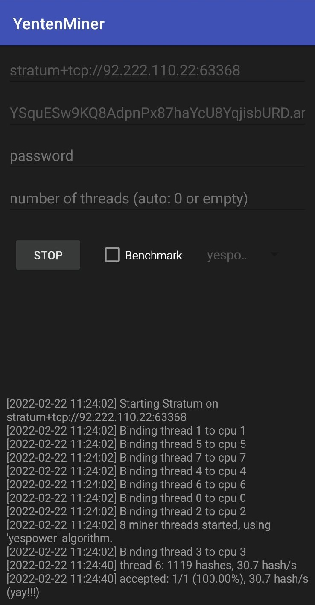
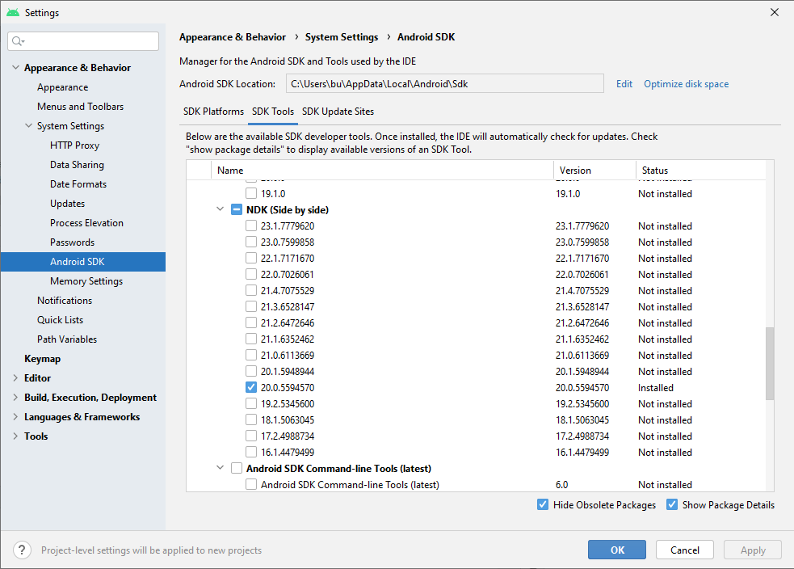
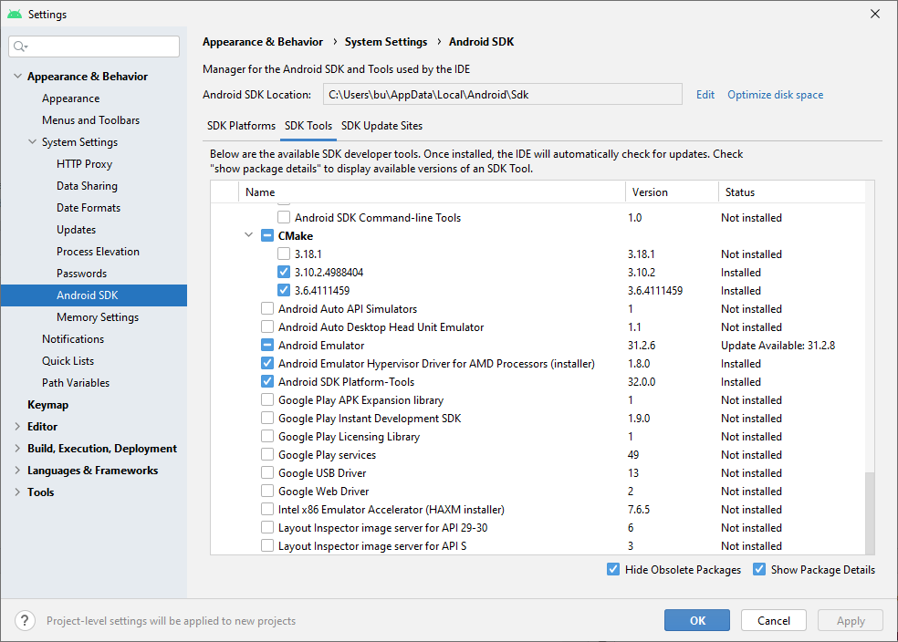

# yenten-android-miner

Android Yenten Miner for yespowerr16 algo. Android studio cpuminer


## Build environment

The project uses Android Gradle Plugin 8.6.1 and Gradle 8.7. Build with JDK 17,
Android SDK platform 34, Android NDK 27.1.12297006, and ARM-native CMake 3.28.3.
On Linux ARM, the SDK must include ARM64 host binaries for both CMake and NDK;
the stock Google packages are x86_64-only.

On ARM Linux, use the workspace's `android-arm-build` skill so Gradle uses the
ARM-compatible `aapt2` binary. The debug APK is written to
`app/build/outputs/apk/standard/debug/app-standard-debug.apk`.









### Constructors


```
public BitZenyMiningLibrary()
```
```
public BitZenyMiningLibrary(Handler handler)
```

Library `putString` log strings with 'log' tag. Applications can `getString` then use the log strings.


### Methods

```
public boolean isMiningRunning()
public int startMining(String url, String user, String password, int n_threads)
public int startBenchmark(int n_threads)
public int stopMining()
```

### copyright
OttyLab - 2018
Yentencoin - 2022
