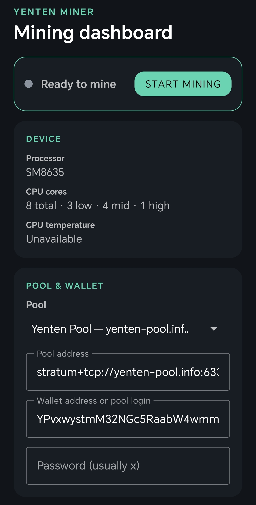

# Yenten Android Miner

An Android CPU miner for Yenten, built around a Java UI and a native C/C++
cpuminer engine. Current app version: **1.3.0** (`versionCode` **4**).



## Features

- Mines with `yespowerr16` (default) or `yescryptr16`.
- Includes Yenten Pool (`yenten-pool.info:63368`), CPU Pool
  (`cpu-pool.com:63368`), and a custom pool option.
- Runs mining in a foreground service with a persistent status notification,
  stop action, and CPU wake lock.
- Shows processor model, total cores, available efficiency/performance core
  groups, and CPU temperature when Android exposes the relevant sensor data.
- Provides dark, light, and Matrix themes; English, Russian, and Simplified
  Chinese UI; and a scrollable miner log.
- Includes a benchmark mode and automatic thread selection when the thread
  count is left blank.
- **Test functionality:** creates and stores a Yenten address and encrypted WIF,
  exports a backup, opens the Yenten web wallet, and checks the public address
  balance through the Yenten API.

Temperature and core-cluster information depend on files exposed by the device's
Android kernel. If those readings are restricted or absent, the app reports the
data as unavailable.

## Build

Requirements:

- JDK 17
- Android SDK platform 34 and build tools
- Android NDK 27.1.12297006
- CMake 3.28.3
- Gradle 8.7, provided by the Gradle wrapper

Set `sdk.dir` in the ignored `local.properties` file, then run from the project
root:

```bash
./gradlew --no-daemon assembleDebug
```

The debug APK is created at:

```text
app/build/outputs/apk/standard/debug/app-standard-debug.apk
```

The project builds native libraries for `arm64-v8a`, `armeabi-v7a`, `x86`, and
`x86_64`. Linux ARM64 hosts need ARM64-compatible Android build tools, NDK host
tools, CMake, Ninja, and `aapt2`. The checked-in `gradle.properties` contains a
workspace-specific `aapt2` override; change it to a valid local path when
building elsewhere. See [PROJECT.md](PROJECT.md) for architecture, dependencies,
ARM build notes, and release signing details.

## Library API

`BitZenyMiningLibrary` exposes the following methods:

```java
boolean isMiningRunning();
int startMining(String url, String user, String password, int nThreads,
                BitZenyMiningLibrary.Algorithm algorithm);
int startBenchmark(int nThreads, BitZenyMiningLibrary.Algorithm algorithm);
int stopMining();
```

Construct the library with an Android `Handler` to receive native log messages.
Read each message from `message.getData().getString("log")`.

## Modules

- `app/` — Android application and UI.
- `bitzenymininglibrary/` — Java/JNI interface and native miner build.
- `distribution/` — bundled headers and prebuilt static zlib, libcurl, and
  Jansson libraries for supported ABIs.

Copyright: OttyLab (2018), Yentencoin (2022).
